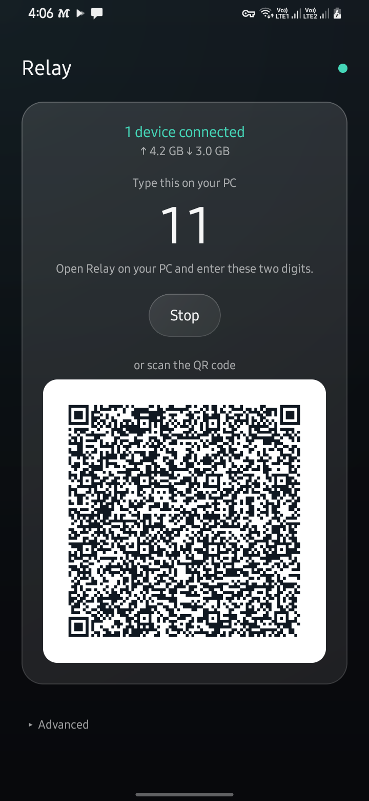
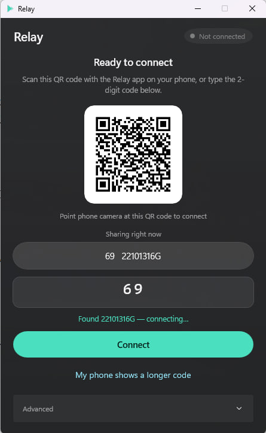
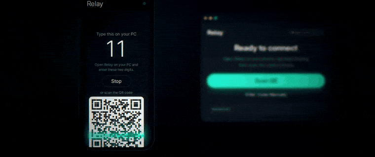
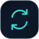
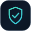

<div align="center">

<picture>
  <source media="(max-width: 640px)" srcset="docs/assets/cover-mobile.svg">
  
</picture>

<br>

[](https://github.com/Mahdi-mortazavi/relay/releases/latest/download/Relay-Setup-x64.exe)
&nbsp;
[](https://github.com/Mahdi-mortazavi/relay/releases/latest/download/Relay-android-arm64-v8a.apk)
&nbsp;
[](#see-it-work)
&nbsp;
[](README.md)

[](https://github.com/Mahdi-mortazavi/relay/releases/latest)
[](https://github.com/Mahdi-mortazavi/relay/releases)
[](https://github.com/Mahdi-mortazavi/relay/stargazers)
[](https://github.com/Mahdi-mortazavi/relay/actions/workflows/ci.yml)
[](https://github.com/Mahdi-mortazavi/relay/actions/workflows/e2e.yml)
[](LICENSE)

</div>

<div dir="rtl" align="center">

**اینترنت گوشی اندرویدت — اینترنت همراه، وای‌فای یا وی‌پی‌ان و فیلترشکنش — را با کامپیوتر ویندوزی‌ات به اشتراک بگذار.**<br>
همهٔ برنامه‌های کامپیوتر، هم TCP هم UDP، از داخل یک تونل رمزنگاری‌شدهٔ WireGuard.<br>
*رایگان و متن‌باز · بدون روت · بدون حساب کاربری · بدون سرور · هیچ‌چیز از این دو دستگاه بیرون نمی‌رود*

[**دانلود**](#download) · [**چطور کار می‌کند**](#how-it-works) · [**با وی‌پی‌ان**](#share-your-phones-vpn) · [**مقایسه**](#relay-vs-tethering-hotspot-and-proxy-apps) · [**پرسش‌های رایج**](#faq) · [**توسعه‌دهنده‌ها**](#for-developers)

</div>

<br>

<div dir="rtl">

<a name="get-online-in-three-steps"></a>
## در سه قدم آنلاین شو

</div>

<div align="center">

| ۳ · گوشی | ۲ · کامپیوتر | ۱ · گوشی |
|:---:|:---:|:---:|
| **اجازه بده** را بزن | گوشی‌ات را از فهرست انتخاب کن<br>یا دو رقمی را که نشان می‌دهد تایپ کن | **شروع اشتراک‌گذاری** را بزن |


&nbsp;&nbsp;&nbsp;


</div>

<div dir="rtl">

دو دستگاه فقط باید به هم برسند: **همان وای‌فای**، **هات‌اسپات گوشی** یا **کابل USB**. اگر کابل
وصل باشد، رله پیشنهاد می‌دهد اشتراک اینترنت با USB را برایت روشن کند.

<a name="how-it-works"></a>
## چطور کار می‌کند

</div>

<div align="center">

</div>

<div dir="rtl">

روی گوشی یک نقطهٔ پایانی کوچک WireGuard اجرا می‌شود و روی کامپیوتر یک کلاینت WireGuard که
کل سیستم را از آن عبور می‌دهد. هر جفت‌شدن کلیدهای تازه می‌سازد، گوشی پیش از ورود هر کامپیوتری
از تو اجازه می‌گیرد، و با پایان اشتراک کلیدها نابود می‌شوند. هیچ سروری در میانه نیست — و
هیچ حساب کاربری‌ای که لازمش کند.

<a name="see-it-work"></a>
## ببین چطور کار می‌کند

</div>

<div align="center">

</div>

https://github.com/user-attachments/assets/fcfbc7ec-e61f-48c0-96b8-cd4713abb49b

<div dir="rtl">

انیمیشن بالا طراحی‌شده است و ویدیو صدا دارد. نسخهٔ واقعی و بدون تدوین: **[راهنمای چهاردقیقه‌ای کسری مکس](https://raw.githubusercontent.com/Mahdi-mortazavi/relay/main/docs/assets/relay-demo-kasra.mp4)** از نصب تا وب‌گردی، با روایت فارسی و زیرنویس انگلیسی. ممنون کسرا، هم برای این ویدیو و هم برای باگ‌هایی که پیدا کردی.

<a name="features"></a>
## چه چیزهایی می‌گیری

<table dir="rtl">
<tr>
<td width="33%" valign="top"><br><b>همهٔ برنامه‌ها، نه فقط مرورگر</b><br>یک تونل WireGuard که هم TCP و هم UDP را می‌برد — بازی، تماس، نصب‌کننده و آپدیت‌ها هم کار می‌کنند.</td>
<td width="33%" valign="top"><br><b>وضعیتی که می‌شود به آن اعتماد کرد</b><br>«متصل» یعنی دست‌دادن واقعی انجام شده. سرعت لحظه‌ای روی گوشی؛ سرعت، حجم و تأخیر روی کامپیوتر.</td>
<td width="33%" valign="top"><br><b>قطع نمی‌شود</b><br>اگر نشانی گوشی عوض شود دنبالش می‌رود و از افت بسته و رفتن از وای‌فای به LTE رد می‌شود.</td>
</tr>
<tr>
<td valign="top"><br><b>بدون نشت، با کلید قطع اضطراری</b><br>DNS و IPv6 نمی‌توانند از کنار تونل بیرون بروند. کلید قطع اضطراری اختیاری، اگر گوشی جواب ندهد اینترنت را می‌بندد.</td>
<td valign="top"><br><b>همیشه یک لمس فاصله</b><br>کاشی تنظیمات سریع، ویجت و میان‌بر روی اندروید؛ برنامه‌ای در سینی سیستم ویندوز که می‌تواند با ویندوز اجرا شود.</td>
<td valign="top"><br><b>فارسی و English</b><br>راست‌به‌چپ درست، با پشتیبانی از TalkBack و Narrator روی هر دو پلتفرم.</td>
</tr>
</table>

<a name="share-your-phones-vpn"></a>
## اشتراک وی‌پی‌ان و فیلترشکن گوشی با کامپیوتر

رله هر اتصالی که گوشی دارد را به اشتراک می‌گذارد — **از جمله وی‌پی‌ان یا فیلترشکنش** — و مسیر
را خودش انتخاب می‌کند و هر ده ثانیه دوباره بررسی می‌کند:

| برنامهٔ وی‌پی‌انت… | چه کنی |
|---|---|
| ترافیک محلی را رد می‌کند (بیشترشان) | هیچ کاری. کار می‌کند. |
| گزینهٔ **«دسترسی شبکهٔ محلی»** / **LAN access** دارد | روشنش کن. |
| **فهرست برنامه‌ها** یا **حالت فقط-پروکسی** دارد | رله را مستثنا کن یا روی فقط-پروکسی بگذار، بعد وی‌پی‌ان را یک بار خاموش و روشن کن. رله پروکسی محلی وی‌پی‌ان را خودش پیدا می‌کند و کامپیوتر همچنان وی‌پی‌ان را می‌گیرد. |

**محدودیت واقعی:** وی‌پی‌انی که هیچ‌کدام از این سه گزینه را نداشته باشد قابل اشتراک نیست —
اندروید به برنامهٔ دیگری اجازهٔ دور زدنش را نمی‌دهد. اگر یک وی‌پی‌ان جواب نداد، معمولاً حالت
فقط-پروکسی‌اش یا یک وی‌پی‌ان دیگر جواب می‌دهد. [جزئیات کامل سازگاری ←](docs/vpn-compat.md)

<a name="relay-vs-tethering-hotspot-and-proxy-apps"></a>
## رله در مقایسه با تترینگ، هات‌اسپات و برنامه‌های پروکسی

| | **رله** | اشتراک با USB | هات‌اسپات گوشی | برنامهٔ پروکسی |
|---|:---:|:---:|:---:|:---:|
| روی همان وای‌فای که داری کار می‌کند | ✅ | — | — | ✅ |
| روی هات‌اسپات یا کابل USB هم کار می‌کند | ✅ | فقط USB | فقط هات‌اسپات | ✅ |
| وی‌پی‌ان گوشی را هم به اشتراک می‌گذارد | ✅ بیشتر وی‌پی‌ان‌ها | ❌ معمولاً نه | ❌ معمولاً نه | ✅ |
| همهٔ برنامه‌های کامپیوتر، TCP **و** UDP | ✅ | ✅ | ✅ | ❌ فقط برنامه‌هایی که تنظیم کنی |
| رمزنگاری بین گوشی و کامپیوتر | ✅ WireGuard | — کابل | ✅ وای‌فای | ❌ معمولاً نه |
| نصب روی کامپیوتر | رله | هیچ | هیچ | تنظیم پروکسی |

<a name="download"></a>
## دانلود

| | فایل | برای |
|---|---|---|
| **ویندوز** | [**Relay-Setup-x64.exe**](https://github.com/Mahdi-mortazavi/relay/releases/latest/download/Relay-Setup-x64.exe) | ویندوز ۱۰ و ۱۱ · فقط برای کاربر خودت نصب می‌شود، بدون نیاز به ادمین |
| **اندروید** | [**Relay-android-arm64-v8a.apk**](https://github.com/Mahdi-mortazavi/relay/releases/latest/download/Relay-android-arm64-v8a.apk) | اندروید ۸ به بالا · تقریباً همهٔ گوشی‌های بعد از ۲۰۱۷ |
| اندروید، همهٔ پردازنده‌ها | [Relay-android-universal.apk](https://github.com/Mahdi-mortazavi/relay/releases/latest/download/Relay-android-universal.apk) | اگر فایل بالا گفت «برنامه نصب نشد» |
| ویندوز ۳۲ بیتی | [Relay-Setup-x86.exe](https://github.com/Mahdi-mortazavi/relay/releases/latest/download/Relay-Setup-x86.exe) | فقط اگر مطمئنی لازمش داری |

- **به‌روزرسانی:** ویندوز وقتی وصل نیستی خودش آپدیت می‌شود. اندروید هر نسخهٔ جدید را پیشنهاد می‌دهد (اندروید نصب بی‌صدا را اجازه نمی‌دهد)، یا با [**Obtainium**](https://apps.obtainium.imranr.dev/redirect?r=obtainium://add/https://github.com/Mahdi-mortazavi/relay) خودکارش کن.
- **بررسی فایل دانلودشده:** هر نسخه فایل [`SHA256SUMS.txt`](https://github.com/Mahdi-mortazavi/relay/releases/latest/download/SHA256SUMS.txt) دارد.

<a name="faq"></a>
## پرسش‌های رایج

<details>
<summary><b>چطور اینترنت گوشی را بدون هات‌اسپات به کامپیوتر بدهم؟</b></summary>
<br>
هر دو را به یک وای‌فای وصل کن (یا کابل USB بزن)، در رلهٔ گوشی <b>شروع اشتراک‌گذاری</b> را بزن، در رلهٔ کامپیوتر گوشی‌ات را انتخاب کن و روی گوشی <b>اجازه بده</b> را بزن. از این به بعد اینترنت کامپیوتر از اتصال خود گوشی بیرون می‌رود.
</details>

<details>
<summary><b>می‌توانم وی‌پی‌ان یا فیلترشکن گوشی را با کامپیوتر به اشتراک بگذارم؟</b></summary>
<br>
بله، با بیشتر برنامه‌های وی‌پی‌ان — بخش <a href="#share-your-phones-vpn">اشتراک وی‌پی‌ان و فیلترشکن گوشی</a> را ببین. اشتراک معمولی با USB و هات‌اسپات معمولاً وی‌پی‌ان گوشی را دور می‌زنند؛ رله ساخته شده که از داخل آن عبور کند.
</details>

<details>
<summary><b>روت، حساب کاربری یا سرور لازم دارد؟</b></summary>
<br>
نه. رله روی هر دستگاه یک برنامهٔ معمولی است. ثبت‌نام و سرور واسطی در کار نیست: ترافیک از کامپیوتر به گوشی و از آنجا بیرون می‌رود، و جای دیگری نمی‌رود.
</details>

<details>
<summary><b>رایگان است؟</b></summary>
<br>
بله. رله متن‌باز است با مجوز GPL-3.0، بدون تبلیغ، بدون اشتراک پولی و بدون ردیابی.
</details>

<details>
<summary><b>روی چه گوشی‌ها و کامپیوترهایی کار می‌کند؟</b></summary>
<br>
اندروید ۸ به بالا، و ویندوز ۱۰ و ۱۱ (۶۴ و ۳۲ بیتی). نسخهٔ لینوکس و مک در <a href="ROADMAP.md">نقشهٔ راه</a> است — کلاینت لینوکس بهترین جا برای مشارکت است.
</details>

<details>
<summary><b>ویندوز موقع نصب هشدار می‌دهد. امن است؟</b></summary>
<br>
نصب‌کننده هنوز امضای دیجیتال ندارد و SmartScreen برای هر فایل بدون امضا هشدار می‌دهد: <b>More info ← Run anyway</b> را بزن. می‌توانی اول فایل را با <code>SHA256SUMS.txt</code> همان نسخه مقایسه کنی.
</details>

<details>
<summary><b>وصل نمی‌شود. حالا چه کنم؟</b></summary>
<br>
صفحه‌های خطای رله می‌گویند چه چیزهایی را امتحان کرده و قدم بعدی چیست — <a href="docs/errors.md">توضیح همهٔ خطاها اینجاست</a>. مشکل نصب اندروید در <a href="docs/install-troubleshooting.md">راهنمای نصب</a> آمده. باز هم حل نشد؟ با فایل لاگ <a href="https://github.com/Mahdi-mortazavi/relay/issues/new/choose">یک issue باز کن</a> (<a href="docs/diagnostics.md">روش گرفتن لاگ</a>).
</details>

<a name="privacy"></a>
## حریم خصوصی

- **بدون حساب کاربری، سرور، تله‌متری یا آنالیتیکس.** جایی برای رفتن داده‌هایت وجود ندارد.
- **کلیدها برای هر جفت‌شدن ساخته و با پایان اشتراک‌گذاری نابود می‌شوند.** هیچ‌وقت پخش نمی‌شوند. کامپیوتری که با کد وصل می‌شود تا روی گوشی **اجازه بده** را نزنی چیزی نمی‌گیرد، و گوشی نامش را نشان می‌دهد.
- **هیچ‌چیز بعد از بسته شدن برنامه نمی‌ماند.** رله هیچ تنظیم سراسری را عوض نمی‌کند، پس یک کرش کامپیوترت را خراب نمی‌کند.

## محدودیت‌های فعلی

- در هر نشست فقط یک کامپیوتر، به‌عمد.
- داخل تونل فعلاً فقط IPv4؛ IPv6 بعداً.
- نصب‌کنندهٔ ویندوز فعلاً امضا ندارد؛ امضا کار بعدی [نقشهٔ راه](ROADMAP.md) است.
- آنچه هنوز روی سخت‌افزار واقعی ثابت نشده در [`docs/testing.md`](docs/testing.md) نوشته شده، نه پنهان.

<a name="for-developers"></a>
## برای توسعه‌دهنده‌ها

</div>

```text
android/   Kotlin + Jetpack Compose        windows/   .NET 8 + WinUI 3
wg/        WireGuard endpoint and client   shared/    the contract both apps are tested against
           (Go, wireguard-go + gVisor)
```

<div dir="rtl">

**مرحلهٔ بیلد محلی وجود ندارد** — CI خودش سیستم بیلد است ([ADR-0004](docs/adr/0004-github-only-build-and-release.md)).
یک برنچ push کن تا بیلد شود، روی ایمیج‌های واقعی اندروید و یک رانر واقعی ویندوز تست شود و
آمادهٔ انتشار باشد. پیش از اولین PR: اول `/shared` را تغییر بده، هر متن را به فارسی و انگلیسی
بنویس، و [`CONTRIBUTING.md`](CONTRIBUTING.md) را بخوان.

| از اینجا شروع کن | |
|---|---|
| [معماری](docs/architecture.md) · [سوابق تصمیم‌ها](docs/adr/) | اجزا چطور کنار هم قرار می‌گیرند، و چرا |
| [`shared/`](shared/) | قالب داده، قواعد جفت‌شدن، ماشین حالت، توکن‌های طراحی |
| [خطاها](docs/errors.md) · [عیب‌یابی](docs/diagnostics.md) | معنی هر خطا؛ روش خواندن لاگ کاربر |
| [تست](docs/testing.md) · [انتشار](docs/release.md) | CI چه چیزی را ثابت می‌کند و سخت‌افزار چه چیزی را |
| [`AGENTS.md`](AGENTS.md) · [`llms.txt`](llms.txt) | برای ایجنت‌ها و دستیارهای هوش مصنوعی |

</div>

<div align="center">


<br>


<div dir="rtl">

**مهدی مرتضوی** · ساختمش چون لپ‌تاپم مدام اینترنت نداشت و گوشی‌ام داشت.<br>
اگر رله به کارت آمد، یک ⭐ کمکش می‌کند. اگر خراب شد، [بگو](https://github.com/Mahdi-mortazavi/relay/issues/new/choose) — همه‌چیز را می‌خوانم.

</div>

[](https://t.me/Mahdi_mortazavi1)
[](https://t.me/Startup_legend)
[](mailto:Mahdi.mortazavi.135@gmail.com)
[](https://mahdi-mortazavi.github.io)

<div dir="rtl">

ساخت ایران · [GPL-3.0](LICENSE) · «WireGuard» علامت تجاری ثبت‌شدهٔ Jason A. Donenfeld است.

</div>

</div>
