<div align="center">

<picture>
  <source media="(max-width: 640px)" srcset="docs/assets/cover-mobile.svg">
  
</picture>

<br>

[](https://github.com/Mahdi-mortazavi/relay/releases/latest/download/Relay-Setup-x64.exe)
&nbsp;
[](https://github.com/Mahdi-mortazavi/relay/releases/latest/download/Relay-android-arm64-v8a.apk)
&nbsp;
[](#see-it-work)
&nbsp;
[](README.fa.md)

[](https://github.com/Mahdi-mortazavi/relay/releases/latest)
[](https://github.com/Mahdi-mortazavi/relay/releases)
[](https://github.com/Mahdi-mortazavi/relay/stargazers)
[](https://github.com/Mahdi-mortazavi/relay/actions/workflows/ci.yml)
[](https://github.com/Mahdi-mortazavi/relay/actions/workflows/e2e.yml)
[](LICENSE)

**Share your Android phone's internet — mobile data, Wi-Fi or its VPN — with your Windows PC.**<br>
Every app on the PC, TCP and UDP, through one encrypted WireGuard tunnel.<br>
*Free and open source · No root · No account · No server · Nothing leaves your two devices*

[**Download**](#download) · [**How it works**](#how-it-works) · [**With a VPN**](#share-your-phones-vpn) · [**Compare**](#relay-vs-tethering-hotspot-and-proxy-apps) · [**FAQ**](#faq) · [**Developers**](#for-developers)

</div>

<br>

<a name="get-online-in-three-steps"></a>
## Get online in three steps

<div align="center">

| 1 · Phone | 2 · PC | 3 · Phone |
|:---:|:---:|:---:|
| Tap **Start Sharing** | Click your phone in the list<br>or type the two digits it shows | Tap **Allow** |


&nbsp;&nbsp;&nbsp;


</div>

The two devices only need to reach each other: **the same Wi-Fi**, **the phone's hotspot** or a
**USB cable**. With a cable plugged in, Relay offers to turn USB tethering on for you.

<a name="how-it-works"></a>
## How it works

<div align="center">

</div>

The phone runs a small WireGuard endpoint; the PC runs a WireGuard client that routes the whole
system through it. Pairing makes fresh keys, the phone asks you before any computer gets in, and
the keys are destroyed when sharing stops. There is no server in the middle — and no account to
make one necessary.

<a name="see-it-work"></a>
## See it work

<div align="center">

</div>

https://github.com/user-attachments/assets/fcfbc7ec-e61f-48c0-96b8-cd4713abb49b

The loop above is drawn; the video has sound. For the unedited real thing, **[KASRA MAX's four-minute walkthrough](https://raw.githubusercontent.com/Mahdi-mortazavi/relay/main/docs/assets/relay-demo-kasra.mp4)** goes from install to browsing (Persian narration, English subtitles) — thank you, Kasra, for that and for the bugs you found.

<a name="features"></a>
## What you get

<table>
<tr>
<td width="33%" valign="top"><br><b>Every app, not just the browser</b><br>One WireGuard tunnel carries TCP <i>and</i> UDP — games, calls, installers and updates all work.</td>
<td width="33%" valign="top"><br><b>Status you can trust</b><br>"Connected" means a real handshake happened. Live speed on the phone; speed, totals and latency on the PC.</td>
<td width="33%" valign="top"><br><b>Keeps going</b><br>Follows the phone to a new address and rides out packet loss and a switch from Wi-Fi to LTE.</td>
</tr>
<tr>
<td valign="top"><br><b>No leaks, optional kill switch</b><br>DNS and IPv6 can't slip around the tunnel. The kill switch blocks the internet if the phone stops answering.</td>
<td valign="top"><br><b>One tap away</b><br>Quick Settings tile, home-screen widget and shortcut on Android; a tray app on Windows that can start with the system.</td>
<td valign="top"><br><b>English and فارسی</b><br>Right-to-left done properly, with TalkBack and Narrator support on both platforms.</td>
</tr>
</table>

<a name="share-your-phones-vpn"></a>
## Share your phone's VPN

Relay shares whatever the phone is online with — **including its VPN** — and picks the route by
itself, re-checking every ten seconds:

| Your VPN app… | What to do |
|---|---|
| Lets local traffic through (most do) | Nothing. It just works. |
| Has **"local network access"** / **"LAN access"** | Turn it on. |
| Has a **per-app list** or a **proxy-only mode** | Exclude Relay, or switch to proxy-only, then turn the VPN off and on. Relay finds the VPN's local proxy, and the PC still gets the VPN. |

**The honest limit:** a VPN with none of those three options can't be shared — Android gives other
apps no way around it. If one VPN doesn't work, its proxy-only mode or another VPN app usually will.
[The full compatibility notes →](docs/vpn-compat.md)

<a name="relay-vs-tethering-hotspot-and-proxy-apps"></a>
## Relay vs. tethering, hotspot and proxy apps

| | **Relay** | USB tethering | Phone hotspot | Proxy app |
|---|:---:|:---:|:---:|:---:|
| Works over the Wi-Fi you already have | ✅ | — | — | ✅ |
| Also works over a hotspot or a USB cable | ✅ | USB only | Hotspot only | ✅ |
| Shares the phone's VPN | ✅ most VPNs | ❌ usually not | ❌ usually not | ✅ |
| Every app on the PC, TCP **and** UDP | ✅ | ✅ | ✅ | ❌ only apps you configure |
| Encrypted between phone and PC | ✅ WireGuard | — cable | ✅ Wi-Fi | ❌ usually not |
| Something to install on the PC | Relay | nothing | nothing | proxy settings |

<a name="download"></a>
## Download

| | File | For |
|---|---|---|
| **Windows** | [**Relay-Setup-x64.exe**](https://github.com/Mahdi-mortazavi/relay/releases/latest/download/Relay-Setup-x64.exe) | Windows 10 and 11 · installs for you alone, no admin rights |
| **Android** | [**Relay-android-arm64-v8a.apk**](https://github.com/Mahdi-mortazavi/relay/releases/latest/download/Relay-android-arm64-v8a.apk) | Android 8 and later · almost every phone since 2017 |
| Android, any CPU | [Relay-android-universal.apk](https://github.com/Mahdi-mortazavi/relay/releases/latest/download/Relay-android-universal.apk) | If the one above says *App not installed* |
| Windows 32-bit | [Relay-Setup-x86.exe](https://github.com/Mahdi-mortazavi/relay/releases/latest/download/Relay-Setup-x86.exe) | Only if you know you need it |

- **Updates:** Windows updates itself while you're not connected. Android offers each update (the platform never allows a silent one), or add Relay to [**Obtainium**](https://apps.obtainium.imranr.dev/redirect?r=obtainium://add/https://github.com/Mahdi-mortazavi/relay) to get them automatically.
- **Check what you downloaded:** every release carries [`SHA256SUMS.txt`](https://github.com/Mahdi-mortazavi/relay/releases/latest/download/SHA256SUMS.txt).

<a name="faq"></a>
## FAQ

<details>
<summary><b>How do I share my phone's internet with my PC without a hotspot?</b></summary>
<br>
Put both on the same Wi-Fi (or connect a USB cable), tap <b>Start Sharing</b> in Relay on the phone, pick the phone in Relay on the PC and tap <b>Allow</b>. The PC's traffic then leaves through the phone's own connection.
</details>

<details>
<summary><b>Can I share my phone's VPN with my PC?</b></summary>
<br>
Yes, with most VPN apps — see <a href="#share-your-phones-vpn">Share your phone's VPN</a>. Ordinary USB tethering and hotspots usually skip the phone's VPN; Relay is built to go through it.
</details>

<details>
<summary><b>Do I need root, an account or a server?</b></summary>
<br>
No. Relay is a normal app on each device. There is no sign-up and no relay server: traffic goes from the PC to the phone and out, and nowhere else.
</details>

<details>
<summary><b>Is it free?</b></summary>
<br>
Yes. Relay is open source under GPL-3.0, with no ads, no subscriptions and no tracking.
</details>

<details>
<summary><b>Which phones and computers does it support?</b></summary>
<br>
Android 8 and later, and Windows 10 and 11 (64-bit and 32-bit). Linux and macOS clients are on the <a href="ROADMAP.md">roadmap</a> — a Linux client is the best place to contribute.
</details>

<details>
<summary><b>Windows says it protected my PC when I run the installer. Is that safe?</b></summary>
<br>
The installer isn't code-signed yet, so SmartScreen warns about any unsigned file: choose <b>More info → Run anyway</b>. You can check the file against <code>SHA256SUMS.txt</code> in the release first.
</details>

<details>
<summary><b>It doesn't connect. What now?</b></summary>
<br>
Relay's error screens say what it already tried and what to do next — <a href="docs/errors.md">every error is explained here</a>. Install problems on Android are covered in <a href="docs/install-troubleshooting.md">install troubleshooting</a>. Still stuck? <a href="https://github.com/Mahdi-mortazavi/relay/issues/new/choose">Open an issue</a> with the log (<a href="docs/diagnostics.md">how to get it</a>).
</details>

<a name="privacy"></a>
## Privacy

- **No accounts, no servers, no telemetry, no analytics.** There is nowhere for your data to go.
- **Keys are made per pairing and destroyed when sharing stops.** They are never broadcast. A computer pairing by code gets nothing until you tap **Allow** on the phone, which shows its name.
- **Nothing outlives the app.** Relay changes no system-wide setting, so a crash can't leave your PC broken.

## Known limits

- One PC per sharing session, by design.
- IPv4 inside the tunnel; IPv6 comes later.
- The Windows installer is unsigned for now; signing is next on the [roadmap](ROADMAP.md).
- What real hardware hasn't proved yet is listed in [`docs/testing.md`](docs/testing.md), not hidden.

<a name="for-developers"></a>
## For developers

```text
android/   Kotlin + Jetpack Compose        windows/   .NET 8 + WinUI 3
wg/        WireGuard endpoint and client   shared/    the contract both apps are tested against
           (Go, wireguard-go + gVisor)
```

**There is no local build step** — CI is the build system ([ADR-0004](docs/adr/0004-github-only-build-and-release.md)).
Push a branch and it is built, tested on real Android images and a real Windows runner, and ready
to release. Before your first pull request: change `/shared` first, write every string in English
and Persian, and read [`CONTRIBUTING.md`](CONTRIBUTING.md).

| Start here | |
|---|---|
| [Architecture](docs/architecture.md) · [Decision records](docs/adr/) | How the pieces fit, and why |
| [`shared/`](shared/) | Wire format, pairing rules, state machine, design tokens |
| [Errors](docs/errors.md) · [Diagnostics](docs/diagnostics.md) | What every error means; how to read a user's log |
| [Testing](docs/testing.md) · [Releasing](docs/release.md) | What CI proves, what hardware still has to |
| [`AGENTS.md`](AGENTS.md) · [`llms.txt`](llms.txt) | For AI coding agents and assistants |


<br>

<div align="center">


**Mahdi Mortazavi** · built because a laptop kept having no internet while the phone did.<br>
If Relay helps you, a ⭐ helps it. If it breaks, [tell me](https://github.com/Mahdi-mortazavi/relay/issues/new/choose) — I read everything.

[](https://t.me/Mahdi_mortazavi1)
[](https://t.me/Startup_legend)
[](mailto:Mahdi.mortazavi.135@gmail.com)
[](https://mahdi-mortazavi.github.io)

Made in Iran · [GPL-3.0](LICENSE) · "WireGuard" is a registered trademark of Jason A. Donenfeld.

</div>
